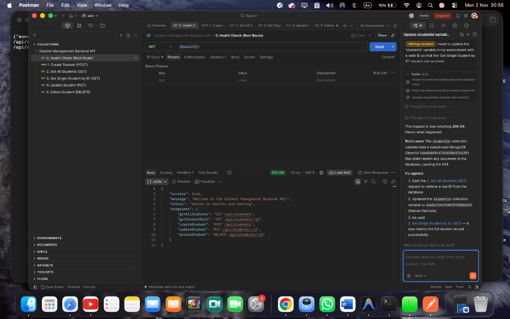
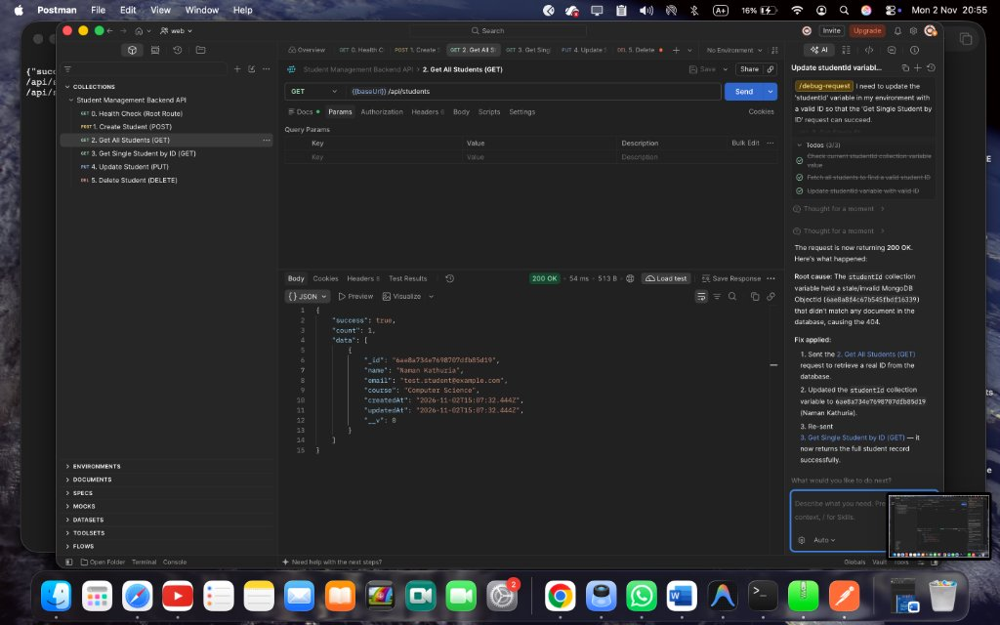
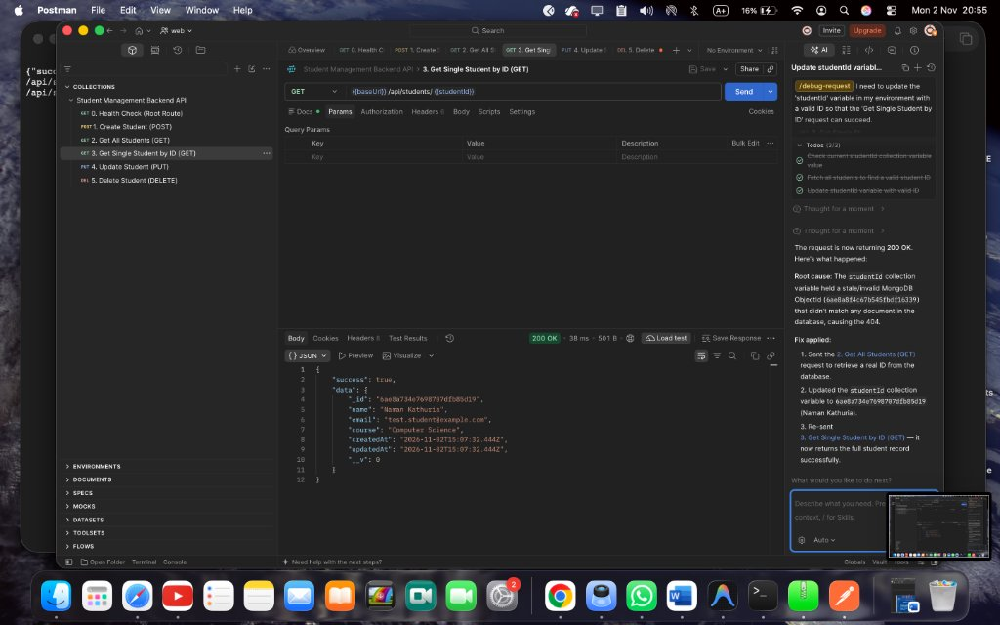
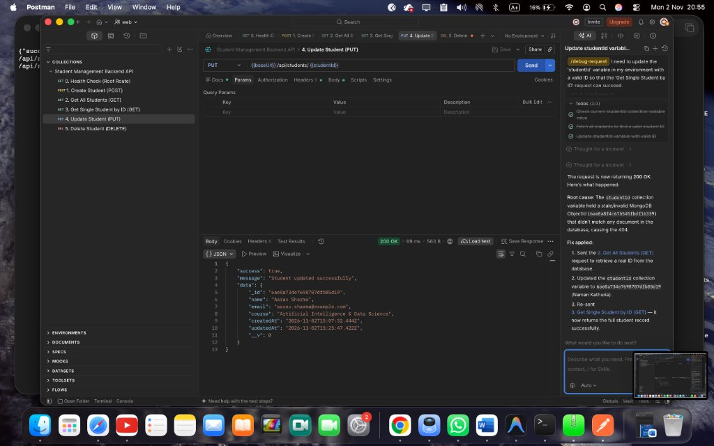

<div align="center">

# 🎓 Student Management System — REST API

A modern, lightweight, beginner-friendly RESTful backend API built with **Node.js**, **Express.js**, and **MongoDB Atlas** using **Mongoose**.

[](https://nodejs.org/)
[](https://expressjs.com/)
[](https://www.mongodb.com/atlas)
[](https://mongoosejs.com/)
[](https://www.postman.com/)

---

[Features](#-key-features) • [Architecture](#-system-architecture) • [Quick Start](#-quick-start) • [API Reference](#-api-endpoints) • [Postman Tests & Screenshots](#-postman-api-testing--screenshots)

</div>

---

## ✨ Key Features

- ⚡ **RESTful Architecture**: Clean CRUD endpoints for student record management.
- ☁️ **Cloud Database**: Fully integrated with MongoDB Atlas via Mongoose ODM.
- 🧩 **MVC Pattern**: Strict separation of concerns (Models, Routes, Controllers, Config).
- 🛡️ **Secure Configuration**: Environment variables isolated via `dotenv` and guarded by `.gitignore`.
- 🧪 **Pre-configured Postman Suite**: 1-click test collection included (`postman_collection.json`).
- 📝 **Clean & Well-Documented**: Intuitive code structure with clear inline documentation.

---

## 🏛️ System Architecture

### Request Flow
```text
┌─────────────────┐       HTTP Requests        ┌───────────────────────┐
│ Postman/Client  │ ─────────────────────────> │   server.js           │
└─────────────────┘                            │ (Middleware & App)    │
                                               └──────────┬────────────┘
                                                          │
                                                          ▼
                                               ┌───────────────────────┐
                                               │ routes/               │
                                               │ studentRoutes.js      │
                                               └──────────┬────────────┘
                                                          │
                                                          ▼
                                               ┌───────────────────────┐
                                               │ controllers/          │
                                               │ studentController.js  │
                                               └──────────┬────────────┘
                                                          │
                                         ┌────────────────┴────────────────┐
                                         ▼                                 ▼
                              ┌──────────────────────┐          ┌──────────────────────┐
                              │ models/Student.js    │          │ config/db.js         │
                              │ (Schema Validation)  │          │ (Atlas Connection)   │
                              └──────────┬───────────┘          └──────────┬───────────┘
                                         │                                 │
                                         └────────────────┬────────────────┘
                                                          │
                                                          ▼
                                               ┌───────────────────────┐
                                               │   MongoDB Atlas       │
                                               │ (students collection) │
                                               └───────────────────────┘
```

### Clean Directory Structure
```text
├── 📁 assets/
│   └── 📁 screenshots/          # Static Postman execution screenshots
├── 📁 config/
│   └── 📄 db.js                 # Database connection & error handling
├── 📁 controllers/
│   └── 📄 studentController.js  # CRUD controller logic
├── 📁 models/
│   └── 📄 Student.js            # Mongoose Schema (Name, Email, Course)
├── 📁 routes/
│   └── 📄 studentRoutes.js      # REST API route declarations
├── 📄 .env.example              # Public environment template
├── 📄 .gitignore                # Protects secrets (.env) & node_modules
├── 📄 package.json              # Dependencies & npm scripts
├── 📄 postman_collection.json   # 1-Click Postman test collection
├── 📄 README.md                 # Project documentation
└── 📄 server.js                 # Application entry point
```

---

## 🚀 Quick Start

### 1. Clone & Install
```bash
git clone https://github.com/namankathuria609-dotcom/student-management-backend.git
cd student-management-backend
npm install
```

### 2. Environment Setup
Create a `.env` file in the root directory:
```env
PORT=5001
MONGO_URI=mongodb+srv://<username>:<password>@cluster0.abcde.mongodb.net/studentDB?retryWrites=true&w=majority
```
> **Note**: Port `5001` is used to prevent port conflicts with macOS ControlCenter / AirPlay Receiver on port `5000`.

### 3. Run the Server
```bash
# Development mode (auto-reload on save)
npm run dev

# Production mode
npm start
```
Server runs at: `http://localhost:5001`

---

## 📡 API Endpoints

**Base URL**: `http://localhost:5001`

| Method | Endpoint | Description | Status Code |
| :--- | :--- | :--- | :--- |
| `GET` | `/` | Health check & endpoint directory | `200 OK` |
| `POST` | `/api/students` | Create and register a new student | `201 Created` |
| `GET` | `/api/students` | Retrieve all students | `200 OK` |
| `GET` | `/api/students/:id` | Retrieve single student by MongoDB ID | `200 OK` |
| `PUT` | `/api/students/:id` | Update student details by ID | `200 OK` |
| `DELETE`| `/api/students/:id` | Remove a student from database | `200 OK` |

### Sample Payload (`POST /api/students` & `PUT /api/students/:id`)
```json
{
  "name": "Aarav Sharma",
  "email": "aarav.sharma@example.com",
  "course": "Computer Science"
}
```

---

## 🧪 Postman API Testing & Screenshots

All API operations were tested using Postman with live responses from MongoDB Atlas. A pre-configured collection is included: [`postman_collection.json`](./postman_collection.json).

### 0. Health Check (Root Route)
- **Method**: `GET`
- **Endpoint**: `http://localhost:5001/`
- **Response**: `200 OK`

<p align="center">
  
</p>

---

### 1. Create Student (POST)
- **Method**: `POST`
- **Endpoint**: `http://localhost:5001/api/students`
- **Response**: `201 Created`
- **Description**: Registers a new student document into MongoDB Atlas with schema validation.

<p align="center">
  
</p>

---

### 2. Get All Students (GET)
- **Method**: `GET`
- **Endpoint**: `http://localhost:5001/api/students`
- **Response**: `200 OK`
- **Description**: Queries and returns all student records sorted chronologically.

<p align="center">
  
</p>

---

### 3. Get Single Student by ID (GET)
- **Method**: `GET`
- **Endpoint**: `http://localhost:5001/api/students/:id`
- **Response**: `200 OK`
- **Description**: Retrieves a specific student record by their MongoDB `_id`.

<p align="center">
  
</p>

---

### 4. Update Student Details (PUT)
- **Method**: `PUT`
- **Endpoint**: `http://localhost:5001/api/students/:id`
- **Response**: `200 OK`
- **Description**: Updates an existing student record and returns the updated document.

<p align="center">
  
</p>

---

<div align="center">
Student Management Backend System • Built with Node.js, Express & MongoDB Atlas
</div>
